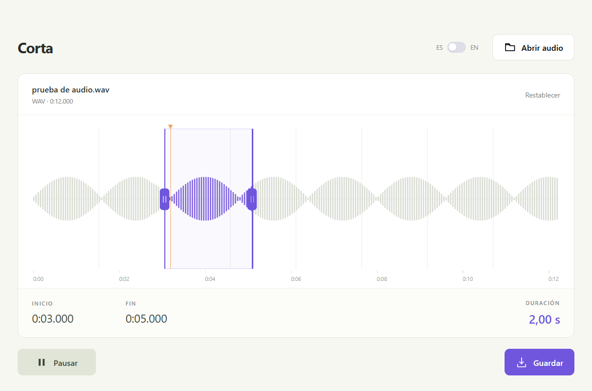

# Corta

**Open audio. Drag the edges. Listen. Save.**

A minimal, offline audio trimmer for Windows. One waveform, a selection, and the controls you need. Built with Electron and FFmpeg.

[Download for Windows](https://github.com/mehLabs/corta/releases/latest) · [Español](README.es.md) · [Contributing](CONTRIBUTING.md)



## Use it

1. Download `Corta-1.0.0-windows-x64.zip` from [Releases](https://github.com/mehLabs/corta/releases).
2. Extract the whole folder and open **Corta.exe**. No installer, Node.js or separate FFmpeg installation required.
3. Open or drop an audio file, drag the purple handles, listen to the selection, and save.

Choose the original file in the save dialog to replace it; Windows asks for confirmation. You can keep editing afterward: the timeline still refers to the audio you originally loaded.

The **ES / EN** switch changes the interface immediately and remembers your choice, preserving the selection and playback. You can also type exact start/end times.

| Shortcut | Action |
| --- | --- |
| `Ctrl+O` | Open audio |
| `Space` | Play / pause selection |
| `Escape` | Stop playback |
| `←` / `→` on a handle | Adjust by 0.01 seconds |
| `Shift` + arrow | Adjust by 1 second |

**Platform:** Windows 10 / 11, x64. Keep the executable with the other extracted files.

**Formats:** opens MP3, WAV, M4A, AAC, FLAC, OGG, OPUS, WMA, AIFF and other FFmpeg-supported audio. Saves MP3, WAV, FLAC, M4A, OGG or OPUS. Cuts are re-encoded for accurate timing; compressed output formats introduce a new encoding pass.

**Local processing:** audio is never uploaded. The temporary preview uses about 10 MB per minute; replacing the original also creates a temporary working copy. These files are removed on normal exit.

## Customize the wording

Edit **textos.json** next to the portable executable, then restart. All application-owned text lives in `locales.es` and `locales.en`.

Keep JSON keys and placeholders such as `{name}`, `{format}`, `{duration}` and `{value}`. `defaultLanguage` sets the initial language; a saved switch preference takes precedence. Native Windows buttons and technical FFmpeg messages come from those components.

For source contributions, edit [`src/textos.json`](src/textos.json). Both languages must contain the same keys.

## Develop

Requirements: **Windows x64, Node.js 22+ and npm**. The Windows `tar.exe` utility is used to extract FFmpeg.

```powershell
git clone https://github.com/mehLabs/corta.git
cd corta
npm ci
npm run setup:ffmpeg
npm start
```

Setup downloads the pinned FFmpeg build and verifies both the archive and executable SHA-256 checksums. Dependencies are pinned in `package-lock.json`; generated binaries are excluded from Git.

```powershell
npm run check       # Fast JavaScript syntax checks
npm test            # Real audio decoding, exports and overwrite behavior
npm run dist        # Build the portable Windows folder and ZIP
npm run test:ui     # Test the packaged app with Playwright
```

Packaging produces `dist/Corta/Corta.exe` and `dist/Corta-1.0.0-windows-x64.zip`. UI tests launch the packaged executable; build it first. They exercise real playback, dragging, exact WAV exports, language changes, persistence and repeated replacement of the original.

If you already have a compatible FFmpeg build, set `CORTA_FFMPEG` to its executable for development/testing. Release packaging uses the pinned `vendor/ffmpeg` installation. `CORTA_APP_PATH` can select a packaged executable for UI tests.

## Project layout

```text
src/          Electron app, waveform UI and bilingual text catalog
scripts/      Verified FFmpeg setup, checks and portable packaging
tests/        Audio and native Electron integration tests
docs/         Screenshot and portable usage notes
third_party/  FFmpeg version, checksums and build/source information
```

The main process owns file dialogs, temporary audio, FFmpeg and exports. A narrow preload bridge connects the sandboxed renderer. The renderer draws the waveform on canvas and previews the selected range. There is no web server or UI framework build step.

## Contribute

Bug fixes, accessibility improvements, translations and simpler interaction are welcome. Please keep Corta focused on quick visual audio trimming.

Read [CONTRIBUTING.md](CONTRIBUTING.md), open an [issue](https://github.com/mehLabs/corta/issues) for a bug or proposal, or send a pull request. Include the user-visible change and the checks you ran. Windows CI runs the audio and packaged-app tests for pull requests.

## License and credits

Corta is licensed under [Apache 2.0](LICENSE), preserving this repository's original license. Electron and the separate, unmodified FFmpeg executable retain their own licenses. See [third-party notices](THIRD_PARTY_NOTICES.md) and the notices included in the portable download.
